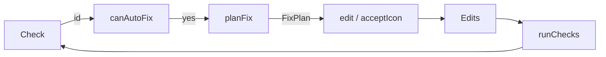

# Data Model: Automatic Check Fixes

No new persisted entity and no new file format: everything here is in-memory shapes alongside the
ones `src/types.ts` and `src/services/edit/edits.ts` already define.

## FixPlan

What applying one fix (single or part of "Fix everything") does.

| Field | Type | Notes |
|---|---|---|
| `summary` | `string` | One sentence for the banner and for "Fix everything"'s combined message, e.g. "Resized and centred the colour icon." |
| `ids` | `string[]` | Every check id this plan is expected to turn green (for the combined message and for tests) |
| `fields` | `Partial<Record<FieldPath, string>>` | Name/description/accent colour changes, same shape `Edits.fields` already has |
| `icon` | `{ slot: IconSlot; bytes: Uint8Array } \| null` | A replaced icon, same shape the image editor's `onApply` already takes |

A `FixPlan` never mixes concerns it does not need to: a text fix sets `icon: null`, an icon fix
sets `fields: {}`.

## Relationships to existing data

- `Check` (`src/types.ts`) is unchanged: this feature reads `id` and `verdict`, nothing else.
- `Edits` (`src/services/edit/edits.ts`) is unchanged: a fix produces exactly the same shape of
  patch a manual edit already produces.
- `IconSlot`, `FieldPath` (`src/services/edit/fields.ts`) are unchanged and reused as-is.

## UndoSnapshot (new, session-only, not a persisted entity)

Held in the page's existing in-memory `State` (`src/app.ts`), next to `edits`:

| Field | Type | Notes |
|---|---|---|
| `edits` | `Edits` | The edits exactly as they were immediately before the fix (single or bulk) ran |
| `summary` | `string` | What the banner says happened, so "Undo" can be labelled meaningfully |

Cleared (`null`) whenever: another edit happens (field, icon, suffix, version bump, revert), a
package is loaded or removed, or the active step changes away from Checks (step 5).
